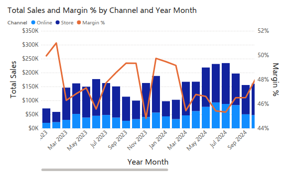
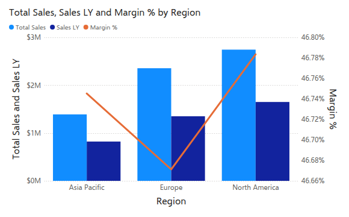

# Combo charts

> **Applies to:** Creators · Analysts

A combo chart draws columns and lines in one visual, so you can show two measures with different scales over the same axis, such as sales and margin percentage. Lumen offers the two combo charts of Power BI Desktop.

| Visual | Type ID | What it shows |
|---|---|---|
| Line and stacked column chart | `lineStackedColumnComboChart` | Stacked columns (split by the column legend) plus lines. |
| Line and clustered column chart | `lineClusteredColumnComboChart` | Clustered columns (one per measure or legend value) plus lines. |

## When to use

- Use a combo chart when one measure is an amount and the other a rate or a ratio (sales and margin %, orders and conversion).
- Use the stacked variant when the column measure has parts (a column legend); use the clustered variant to compare several column measures side by side.
- If both measures have the same unit, a clustered column chart or a line chart with two lines is usually clearer.

## Field wells

| Well | Takes | Notes |
|---|---|---|
| X-axis | Columns or hierarchies | The shared axis. |
| Column y-axis | Measures | Drawn as columns on the left scale. |
| Line y-axis | Measures | Drawn as lines on the secondary (right) scale. |
| Column legend | One column | Splits the column measure into series. |
| Small multiples | Column | One small chart per value. |
| Tooltips | Measures | Extra values in the tooltip. |

When you add fields, combo charts sort by their axis, ascending, as Power BI Desktop does.

## Format options

The **Visual** tab groups the options as follows; see the [format properties reference](../reference/format-properties/combo-charts.md) for every property.

- **Legend**, **Small multiples**, **Small multiple title**.
- **X-axis**, **Y-axis** (the column scale) and **Secondary y-axis** (the line scale).
- **Columns**: colors and transparency; **Lines**: width, style, interpolation and markers.
- **Data labels**, **Series labels**, and **Total labels** (line and stacked column chart).
- **Plot area background**, **Zoom slider**.

The **Analytics** tab ("Add further analyses to your visual") offers the constant, min, max, average, median, percentile and trend lines, and **Error bars**.

## Interactions

Columns and line points are selectable: selecting one cross-filters or cross-highlights the page, and Ctrl+click adds to the selection. Drill down and up work on the X-axis as in the other cartesian charts.

## Differences from Power BI Desktop

- Line data labels: every **Position** value except **Below** draws the label above the point.

## Related content

- [Bar and column charts](bar-and-column-charts.md)
- [Line and area charts](line-and-area-charts.md)
- [Format a visual](../create-reports/format-a-visual.md)
- [Tutorial: design a dashboard page](../create-reports/tutorial-design-a-dashboard-page.md)
- [Format properties: combo charts](../reference/format-properties/combo-charts.md)
