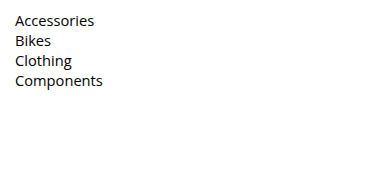
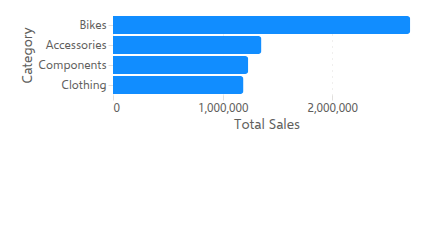
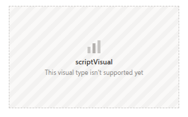

# Custom and script visuals

> **Applies to:** Creators · Developers

Power BI reports can contain custom visuals from AppSource or an organization, and R or Python script visuals. Lumen cannot run custom visual packages or scripts. Instead it re-implements three widely used custom visuals (**HTML Content**, **Deneb** and **Power Automate for Power BI**) and shows a placeholder for everything else. This article lists what works and what you see otherwise.

| Visual | Type ID | In Lumen |
|---|---|---|
| HTML Content | `htmlContent443BE3AD55E043BF878BED274D3A6865` (any `htmlContent` + GUID) | Rendered by Lumen. |
| Deneb | `deneb7E15AEF80B9E4D4F8E12924291ECE89A` (any `deneb` + GUID) | Rendered by Lumen with the Vega library. |
| Power Automate for Power BI | `FlowVisual_C29F1DCC_81F5_4973_94AD_0517D44CC06A` | The button renders; flows do not run. |
| R script visual | `scriptVisual` | Placeholder. |
| Python visual | `pythonVisual` | Placeholder. |
| Any other custom visual | its GUID-suffixed type | Placeholder. |

The three re-implemented visuals are in the Visualizations pane gallery, so you can also add them to a new report.

## HTML Content

HTML Content renders the values of its **Values** well as HTML: typically a measure that returns HTML text, or a column. Add columns to **Granularity** to render one entry per row.

- **Format options**: **Content formatting** (**Show raw HTML**, default font family, size and color, **Alignment**, **Allow opening URLs**, **Allow text selection**, **No data message**) and **Stylesheet** (CSS for the content).
- Allowed: inline styles, `<style>` blocks (including animations), SVG, tables, images (http, https and data URIs) and links.
- Removed for safety: scripts, event-handler attributes, `javascript:` URLs, frames, objects, embeds, forms and meta refreshes. The content is drawn in a sandboxed frame that cannot run scripts.

## Deneb

Deneb draws a Vega or Vega-Lite specification with the fields of its **Values** well as the dataset.

- The data is available as the dataset named `dataset`. Each field is named by its display name (for example `Total Sales`); Lumen also adds `<measure>__formatted` (the formatted text), `__row__`, `__selected__` and `__identity__`, as Deneb does.
- The expression functions `pbiColor(index, shade)`, `pbiFormat(value, format)` and `pbiFormatAutoUnit(value, format)` use the report theme and Lumen's formatter.
- **Format options**: **Specification** (**Provider**: Vega-Lite or Vega; **Specification (JSON)**; **Config (JSON)**; **Tooltips**; **Render mode**: SVG or Canvas).
- Without a specification the visual reads "No specification has been provided (open the Deneb editor in Power BI to create one)."

Lumen has no Deneb editor: edit the JSON in the Format pane's **Specification (JSON)** box, or open a report that already has a specification.

## Power Automate for Power BI

The **Run flow** button renders with its saved formatting (**Button text**, **Fill**, with default, hover and selected states). Flows run only in the Power BI service: clicking the button (Ctrl+click while editing) shows "Flows run only in the Power BI service" and triggers nothing.

## R and Python visuals, and other custom visuals

- **R script visual** and **Python visual** are in the gallery and keep their fields, but the canvas shows a hatched placeholder that reads "This visual type isn't supported yet". Lumen does not run R or Python.
- Any other AppSource or organizational custom visual shows a placeholder with the visual's name (read from the package embedded in the report when there is one) and "This custom visual isn't supported in Lumen".
- Lumen keeps these visuals and their packages unchanged when it saves a PBIP project, so the visuals still work when the report is opened in Power BI Desktop. This round trip is designed in, but has not been verified in Power BI Desktop.

## Differences from Power BI Desktop

- The three supported custom visuals are Lumen re-implementations, not the AppSource packages; they read the same saved settings, but rendering details can differ from the published versions.
- No custom visual can be imported from a `.pbiviz` file, and no AppSource visual can be downloaded.
- R and Python scripts never run, so their visuals are always placeholders.

## Related content

- [Visual support reference](../reference/visual-support.md)
- [Elements](elements.md)
- [File format support](../reference/file-format-support.md)
- [Format properties: custom visuals](../reference/format-properties/custom-visuals.md)
