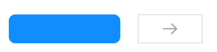
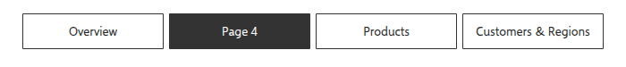

# Elements

> **Applies to:** Creators

Elements are the visuals that do not chart data: text boxes, shapes, images, buttons and navigators. You insert them from the **Insert** ribbon tab rather than from the Visualizations pane gallery. This article is a short catalog; the how-to articles linked below explain each one step by step.

| Element | Type ID | Insert it with | Article |
|---|---|---|---|
| Text box | `textbox` | **Insert > Text box** | [Text boxes, shapes and images](../create-reports/text-boxes-shapes-and-images.md) |
| Shape | `shape` (also read: `basicShape`) | **Insert > Shapes** (rectangle, rounded rectangle, oval, arrows, chevron, heart, speech bubble and more) | [Text boxes, shapes and images](../create-reports/text-boxes-shapes-and-images.md) |
| Image | `image` | **Insert > Image > Image from file…**; **Insert > Icon** for a built-in icon | [Text boxes, shapes and images](../create-reports/text-boxes-shapes-and-images.md), [Icons](../create-reports/icons.md) |
| Button | `actionButton` | **Insert > Buttons** (**Left arrow**, **Right arrow**, **Information**, **Help**, **Q&A**, **Bookmark**, **Blank**) | [Buttons and page navigation](../create-reports/buttons-and-page-navigation.md) |
| Page navigator | `pageNavigator` | **Insert > Buttons > Page navigator** | [Buttons and page navigation](../create-reports/buttons-and-page-navigation.md) |
| Bookmark navigator | `bookmarkNavigator` | Not insertable in Lumen; rendered when a report contains one | [Bookmarks](../create-reports/bookmarks.md) |

## Field wells

Elements have no field wells. A text box can show dynamic values (including smart narratives saved by Power BI Desktop), and an action's destination can be bound to a measure that returns the page, bookmark or URL; see the how-to articles.

## Format options

The [format properties reference](../reference/format-properties/elements.md) lists every property.

- **Shape**: **Shape**, **Rotation**, **Fill**, **Border**, **Text**, **Shadow**, **Glow**, and **Action** on the General tab.
- **Image**: **Image** (source and scaling: **Normal**, **Fit**, **Fill**) and **Action**.
- **Button**: **Shape**, **Text**, **Icon**, **Fill**, **Border**, **Shadow**, **Glow**, and **Action**.
- **Page navigator** and **Bookmark navigator**: **Grid layout** (horizontal, vertical or grid), **Pages** or **Bookmarks** (which ones to show), **Shape**, **Text**, **Fill**, **Border**, **Shadow**, **Glow**.
- **Text box**: double-click it to edit the text in place; the Format pane's Visual tab has no cards for it (use the General tab for title, background and border).

## Actions

Shapes, images and buttons can run an **Action** (General tab): **Back**, **Bookmark**, **Drillthrough**, **Page navigation**, **Q&A**, **Web URL**, **Clear all slicers** and **Apply all slicers**. While you edit the report, Ctrl+click follows the action (the tooltip says "CTRL+click here to follow link"). See [Buttons and page navigation](../create-reports/buttons-and-page-navigation.md).

## Differences from Power BI Desktop

- There is no command to insert a **Bookmark navigator**; one saved in a report renders and works.
- Buttons and navigators draw the per-state formatting (hover, pressed, selected, disabled) saved in a report, but the Format pane has no state selector: it edits the default state.
- A smart narrative text box whose summary uses an algorithm Lumen does not implement shows "Smart narrative summary isn't available in Lumen" in place of that summary.
- In the Format pane, the action **Type** list shows "Qn A" and "Web Url" for **Q&A** and **Web URL**, and the button's **Icon > Shape** list shows internal names such as `clearAllSlicers` and `rightArrow`.
- The default outline of a shape inserted from the ribbon is the fill color; Power BI's exact default is not documented.
- Text boxes wrap and measure text with a Segoe UI-like approximation, so line breaks can differ slightly from Power BI Desktop.

## Related content

- [Text boxes, shapes and images](../create-reports/text-boxes-shapes-and-images.md)
- [Buttons and page navigation](../create-reports/buttons-and-page-navigation.md)
- [Icons](../create-reports/icons.md)
- [Bookmarks](../create-reports/bookmarks.md)
- [Format properties: elements](../reference/format-properties/elements.md)
