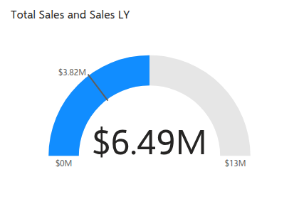
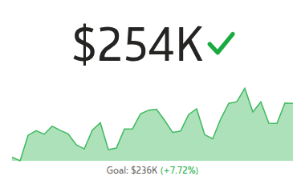

# Gauge and KPI

> **Applies to:** Creators · Analysts

The gauge and the KPI visual show one value against a target. The gauge (`gauge`) draws the value on a semicircular arc; the KPI (`kpi`) shows the value in large type with a status icon, the distance to the goal and a trend area.

## When to use

- Use a **gauge** to show progress toward a target within a range (for example a quota).
- Use a **KPI** to show the latest value of a measure over time, whether it is on track, and the trend behind it.
- For several headline numbers without targets, use a [card](cards.md).

## Field wells

**Gauge**

| Well | Takes | Notes |
|---|---|---|
| Value | One measure | The value on the arc. |
| Minimum value | One measure | Start of the arc. |
| Maximum value | One measure | End of the arc. |
| Target value | One measure | Draws the target line. |
| Tooltips | Measures | Extra values in the tooltip. |

**KPI**

| Well | Takes | Notes |
|---|---|---|
| Value | One measure | The indicator. |
| Trend axis | One column | Usually a date column; the KPI shows the value at the last point of the axis. |
| Target | Up to two measures | The goal(s). |

## How the gauge range is chosen

For each bound, a field in the bound's well wins over the **Gauge axis** format property (**Min**, **Max**, **Target**), which wins over the default:

- **Min** defaults to 0 (or twice the value when the value is negative, so it stays on the arc).
- **Max** defaults to twice the value when the value is positive.
- When the target is larger than the default maximum, Lumen extends the maximum to the target so the target line stays visible.

## Format options

The [format properties reference](../reference/format-properties/gauge-and-kpi.md) lists every property.

**Gauge** (Visual tab): **Gauge axis** (**Min**, **Max**, **Target**), **Colors** (**Fill color**, **Background**, **Target color**), **Data labels** (the min and max labels), **Target label**, **Callout value**.

**KPI** (Visual tab): **Callout value** (font, display units, alignment, **Icon**, **Icon size**), **Trend axis** (show, transparency), **Target label** (goal label, distance label and its direction), **Color coding** (**Direction**, **Good color**, **Neutral color**, **Bad color**), **Date** (the last date of the trend axis).

## Interactions

- A selection in another visual cross-highlights the gauge: the highlighted part of the value is drawn on the arc.
- The KPI is not cross-highlighted: a selection in another visual cross-filters it.

## Differences from Power BI Desktop

- Extending the gauge's maximum to a target above the default maximum is Lumen's choice; Power BI's behaviour in that case is not documented.

## Related content

- [Cards](cards.md)
- [Conditional formatting](../create-reports/conditional-formatting.md)
- [Format a visual](../create-reports/format-a-visual.md)
- [Format properties: gauge and KPI](../reference/format-properties/gauge-and-kpi.md)
