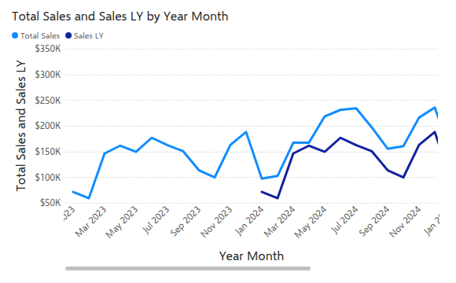
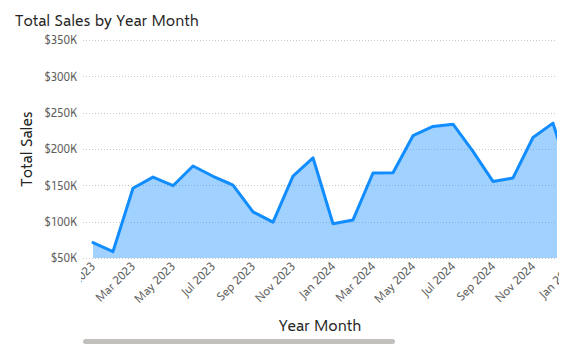
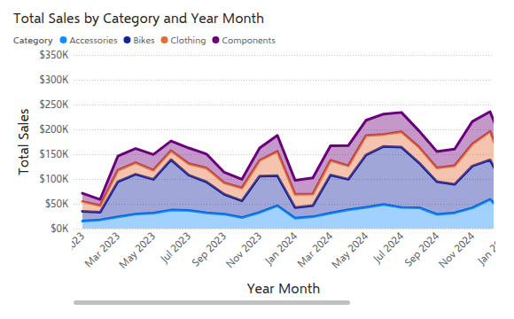
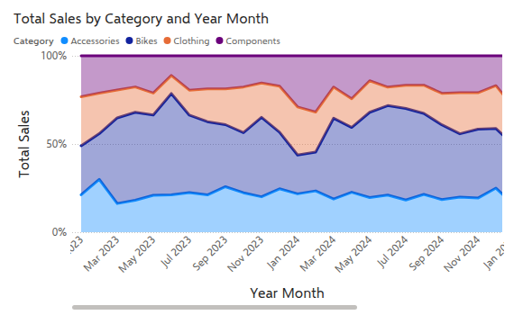

# Line and area charts

> **Applies to:** Creators · Analysts

Line and area charts show how a measure changes along an ordered axis, usually time. This article covers the line chart, area chart, stacked area chart and 100% stacked area chart.

| Visual | Type ID | What it shows |
|---|---|---|
| Line chart | `lineChart` | One line per measure or legend value. |
| Area chart | `areaChart` | Lines with the area below them shaded; areas overlap. |
| Stacked area chart | `stackedAreaChart` | Areas stacked on top of each other: the total and its parts over time. |
| 100% stacked area chart | `hundredPercentStackedAreaChart` | Stacked areas scaled to 100%: shares over time. |

## When to use

- Use a **line chart** for trends and for comparing a few series, such as this year against last year.
- Use an **area chart** to stress the volume under one or two lines.
- Use a **stacked area chart** when the total and its composition both matter, and a **100% stacked area chart** when only the shares matter.

## Field wells

| Well | Takes | Notes |
|---|---|---|
| X-axis | Columns or hierarchies | The axis, usually a date column or a date hierarchy. |
| Y-axis | Measures | One or more values. |
| Secondary y-axis | Measures | Line and area chart only: values drawn against a second scale on the right. |
| Legend | One column | Splits the value into one line per legend value. |
| Small multiples | Column | One small chart per value. |
| Tooltips | Measures | Extra values in the tooltip. |

When you add fields, these charts sort by their axis, ascending, as Power BI Desktop does. A long axis scrolls horizontally, as in the screenshot above, instead of squeezing the points.

## Format options

The **Visual** tab groups the options as follows; see the [format properties reference](../reference/format-properties/line-and-area-charts.md) for every property.

- **Legend**, **Small multiples**, **Small multiple title**.
- **X-axis**, **Y-axis** and, for line and area charts, **Secondary y-axis**.
- **Lines**: width, line style, transparency, interpolation (including step), shaded area, and markers (shape, size, color).
- **Data labels** and **Series labels** (a label at the end of each line).
- **Total labels** (stacked area chart).
- **Plot area background**, **Zoom slider**.

The **Analytics** tab ("Add further analyses to your visual") offers constant lines on the Y-axis (and on the X-axis when the axis is continuous), min, max, average, median and percentile lines, and a trend line. For the line chart it also offers **Error bars** and **Forecast**, and for line and area charts **Find anomalies**.

## Interactions

- Select a point to cross-filter or cross-highlight the page; Ctrl+click adds to the selection.
- Drill down and up on a date hierarchy or several axis fields from the visual header or the context menu.
- Hover a point for its tooltip; anomalies show "Anomaly: Yes (approximate detection)" in the tooltip.

## Differences from Power BI Desktop

- **Forecast** uses exponential smoothing with Lumen's own initialisation. Power BI does not publish its algorithm, so forecast values and confidence bands can differ from Power BI Desktop's.
- **Find anomalies** uses a robust statistical method, not Power BI's Azure model, and needs at least 12 points. The visual says the detection is approximate.
- On lines, **Data labels > Position** draws every value except **Below** above the point (Power BI's **Auto** placement is not documented). A label that would overlap one already drawn is dropped.

## Related content

- [Bar and column charts](bar-and-column-charts.md)
- [Combo charts](combo-charts.md)
- [Format a visual](../create-reports/format-a-visual.md)
- [Drill down and drill through](../create-reports/drill-down-and-drillthrough.md)
- [Format properties: line and area charts](../reference/format-properties/line-and-area-charts.md)
