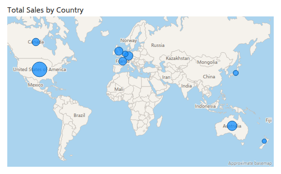
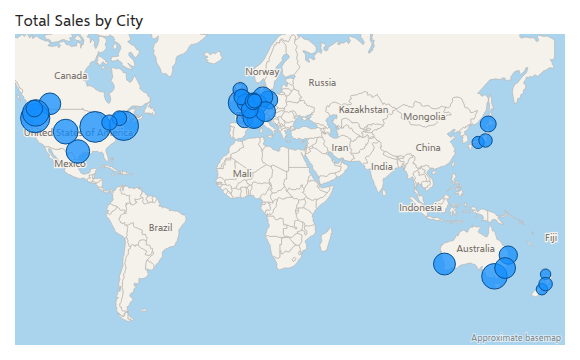
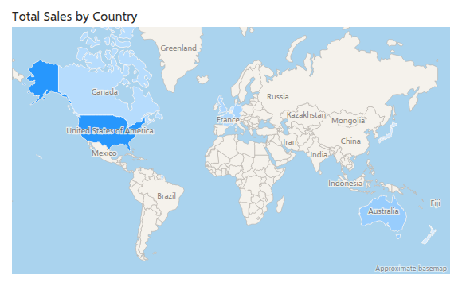
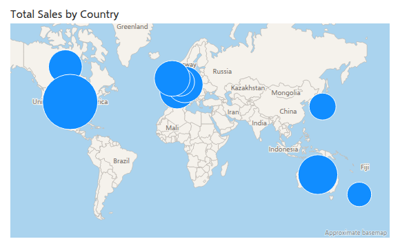
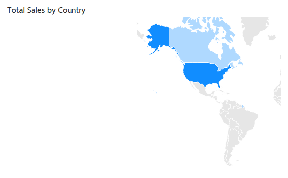

# Maps

> **Applies to:** Creators · Analysts

Lumen draws four map visuals: **Map** (`map`, bubbles), **Filled map** (`filledMap`, shaded areas), **Azure map** (`azureMap`, a bubble layer) and **Shape map** (`shapeMap`). All four work offline: Lumen does not download map tiles and does not call an online geocoding service, so read this article before you rely on a map.

## What Lumen draws, and from which data

**Basemap.** Instead of Bing or Azure Maps tiles (roads, terrain, imagery, place labels), Lumen draws vector outlines of the world's countries (Natural Earth / world-atlas at 1:110m) and of the US states (us-atlas, 1:10m), colored to evoke the selected map style, with the names of large countries as labels. The visual shows the caption **Approximate basemap**.

**Locations.** Values in **Location** are matched against tables built into Lumen:

| Kind of location | What Lumen knows | Placement |
|---|---|---|
| Countries | All countries, by name and ISO codes | Country shape (filled) or its centre (bubbles). |
| US states | Names, USPS codes, FIPS codes | State shape or centre. |
| Continents | Continent names | The countries of the continent (filled) or a centroid. |
| Regions (states and provinces of other countries) | Natural Earth admin-1 regions | An approximate centre point. |
| Cities and places | About 6,500 world cities and about 15,000 US places with at least 1,000 inhabitants | A point. |
| US ZIP codes | The first three digits (ZIP3) | The centre of the ZIP3 area (approximate). |

To resolve ambiguous names, Lumen uses the column's **Data category** (City, State or Province, Country, Postal code, Continent, Place, Address, County; set it with **Data category** on the column's ribbon tab or in the Properties pane), the coarser levels of a geography hierarchy or of the drill path, qualifiers inside the value ("Austin, TX", "Paris, France"), and the country most values of the column belong to. A value Lumen cannot resolve is not guessed: the caption reports it as "*n* not located".

**Latitude and longitude.** When **Latitude** and **Longitude** are set, they place the bubbles exactly and no lookup is needed.

## The four map visuals

| Visual | Draws | Wells | Notes |
|---|---|---|---|
| Map | A bubble per location, sized by **Bubble size** | Location, Legend, Latitude, Longitude, Bubble size, Tooltips | With a Legend, each bubble is a small pie. |
| Filled map | The shape of each location, shaded by **Color saturation** | Location, Legend, Latitude, Longitude, Color saturation, Tooltips | Can fill countries, US states and continents only (no city or postal-code areas). Latitude and longitude alone cannot fill an area. |
| Azure map | A bubble layer, sized by **Size** | Location, Legend, Latitude, Longitude, Size, Tooltips | Same basemap as the Map; only the bubble layer of Power BI's Azure map is drawn. |
| Shape map | Shaded shapes on a plain background | Location, Legend, Color saturation, Tooltips | Uses the US states map (Albers USA projection, Alaska and Hawaii as insets) when the locations are US states, otherwise the world map. |

## Format options

The [format properties reference](../reference/format-properties/maps.md) lists every property.

- **Map** and **Filled map**: **Style** (**Road**, **Aerial**, **Dark**, **Light**, **Grayscale**; **Labels**), **Controls** (**Auto zoom**, **Zoom buttons**), **Legend**, **Bubbles** (**Size**) or **Fill colors**, **Category labels**.
- **Azure map**: **Style** (Road, Grayscale light, Grayscale dark, Night, Road shaded relief, Satellite, Hybrid, High contrast dark, High contrast light; **Labels**), **Controls**, **Legend**, **Bubble layer** (size, minimum and maximum size, border, transparency), **Bubble colors**, **Category labels**.
- **Shape map**: **Map settings** (**Projection**: Mercator, Equirectangular, Orthographic), **Legend**, **Fill colors**, **Default colors** (blank area color, border), **Data labels**, **Zoom** (**Manual zoom**, **Zoom buttons**).

Every style is an approximation: Lumen recolors the same outlines (for example, **Aerial** and **Satellite** become dark green-brown land on deep-blue water).

## Interactions

- Scroll to zoom, drag to pan, double-click to reset the view; **Controls > Zoom buttons** adds buttons.
- Select a bubble or shape to cross-filter or cross-highlight the page; Ctrl+click adds to the selection.
- Drill down and up on a geography hierarchy in **Location**.

## Differences from Power BI Desktop

- No tiles: there are no roads, terrain, imagery or detailed place labels, and a location's surroundings look different from Power BI's map.
- Geocoding is offline and limited to the tables above. Street addresses, most postal codes outside the US, counties and small places are reported as not located, where Power BI's Bing / Azure Maps geocoding would find them. Add **Latitude** and **Longitude** columns for exact placement.
- US ZIP codes are placed at the centre of their three-digit prefix, so all ZIP codes that share the first three digits share a point.
- Filled and shape maps cannot draw city or postal-code boundaries. The shape map does not read custom map files (TopoJSON); its map type is fixed to Lumen's built-in geometry.
- Without explicit colors, the saturation gradient runs from a light tint of the data color to the data color itself, an approximation of Power BI's defaults.
- In testing, a **Shape map** of countries drew a cropped part of the world (the Americas with Europe cut off at the edge) rather than fitting the shaded countries.

## Related content

- [Visual support reference](../reference/visual-support.md)
- [Visual interactions](../create-reports/visual-interactions.md)
- [Drill down and drill through](../create-reports/drill-down-and-drillthrough.md)
- [Model data](../model-data/README.md)
- [Format properties: maps](../reference/format-properties/maps.md)
