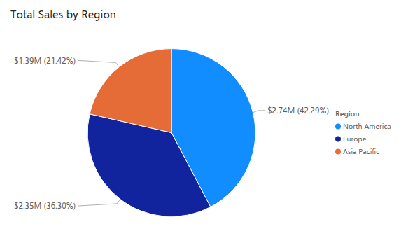
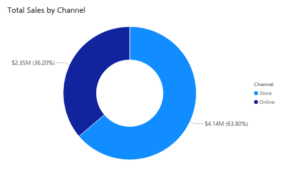
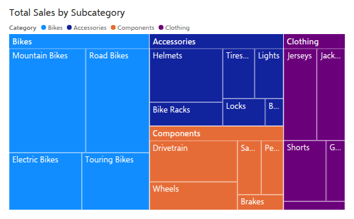

# Pie, donut and treemap

> **Applies to:** Creators · Analysts

Pie charts, donut charts and treemaps show how a total divides into parts. This article covers the pie chart (`pieChart`), the donut chart (`donutChart`) and the treemap (`treemap`).

## When to use

- Use a **pie** or **donut** chart for a few parts (up to five or six) of one total. The donut's hole leaves room for a card or a title.
- Use a **treemap** for many parts or two levels (category and subcategory): the rectangles stay readable where slices would be too thin.
- To compare parts precisely, a [bar chart](bar-and-column-charts.md) is easier to read.

## Field wells

**Pie and donut chart**

| Well | Takes | Notes |
|---|---|---|
| Legend | Columns or hierarchies | One slice per value, each in its own palette color. |
| Values | Measures | The slice size. Without a Legend, each measure is a slice. |
| Details | One column | Splits each legend slice into sub-slices of the legend's color; without a Legend, the details become the slices. |
| Small multiples | Column | One small pie per value. |
| Tooltips | Measures | Extra values in the tooltip. |

**Treemap**

| Well | Takes | Notes |
|---|---|---|
| Category | Columns or hierarchies | The groups, each in its own palette color. |
| Details | One column | Tiles inside each group, in the group's color. |
| Values | Measures | The tile size. |
| Tooltips | Measures | Extra values in the tooltip. |

## Format options

The **Visual** tab groups the options as follows; the [format properties reference](../reference/format-properties/pie-donut-treemap.md) lists every property.

**Pie and donut chart**

- **Legend**.
- **Rotation** (pie) and **Slices**: the donut's **Inner radius** and **Rotation**, and the slice colors (**Default color**, a color per slice, **Transparency**).
- **Data labels**: **Label contents** (data value, percent of total, category), **Position** (outside, inside, prefer outside, prefer inside), **Overflow text**, background, display units and decimal places. Outside labels sit at each slice's middle with grey leader lines; a label that is too wide wraps onto two lines before it is truncated.
- **Small multiples**, **Small multiple title**.

**Treemap**

- **Legend** (lists the groups; shown by default when **Details** is used), **Colors**.
- **Data labels** (off by default) and **Category labels** (on by default).
- **Layout**: **Tiling method** (**Squarified**, **Binary**, **Alternating**), **Inner padding (px)**, **Outer padding (px)**.

## Interactions

- Select a slice or tile to cross-filter or cross-highlight the page; Ctrl+click adds to the selection. When another visual highlights a treemap, the highlighted share fills each tile from the bottom over a faded tile.
- Drill down and up on a hierarchy in **Legend** (pie, donut) or **Category** (treemap).

## Differences from Power BI Desktop

- The donut chart's Format pane shows two cards named **Slices**: the first holds **Inner radius** and **Rotation**, the second the slice colors.
- The pie and donut charts' **Data labels** card lists two properties named **Background**: an on / off switch and a list with **Off**, **On** and **Auto**.

## Related content

- [Bar and column charts](bar-and-column-charts.md)
- [Cards](cards.md)
- [Visual interactions](../create-reports/visual-interactions.md)
- [Format properties: pie, donut and treemap](../reference/format-properties/pie-donut-treemap.md)
