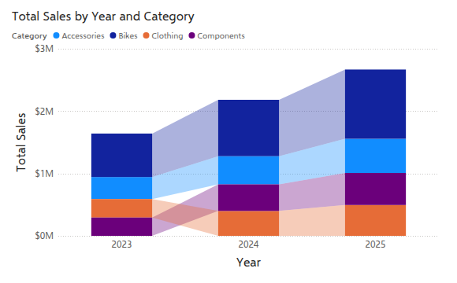
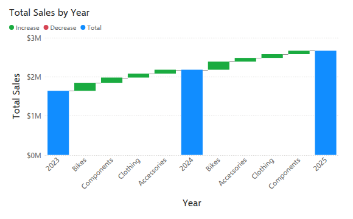
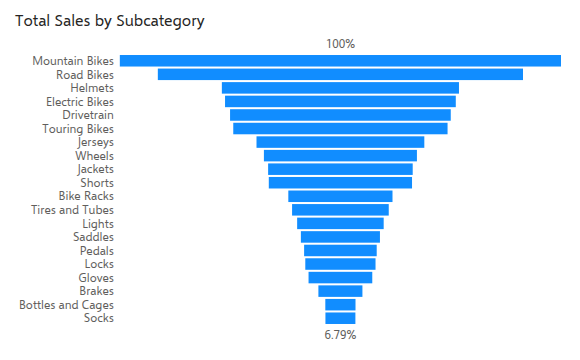

# Ribbon, waterfall and funnel charts

> **Applies to:** Creators · Analysts

These three charts show change: how the ranking of categories changes over time (ribbon), how a starting value turns into an end value through increases and decreases (waterfall), and how a quantity shrinks from one stage to the next (funnel).

## Ribbon chart

A ribbon chart (`ribbonChart`) is a stacked column chart in which each stack is sorted so the largest value is on top, and ribbons connect the same legend value from one column to the next. A ribbon that crosses another shows a change of rank.

**When to use**: to show which category leads in each period and when the lead changes.

| Well | Takes | Notes |
|---|---|---|
| X-axis | Columns or hierarchies | Usually time. |
| Legend | One column | One ribbon per value. |
| Y-axis | Measures | The value. |
| Small multiples | Column | One small chart per value. |
| Tooltips | Measures | Extra values in the tooltip. |

**Format options** (Visual tab): **Legend**, **X-axis**, **Y-axis**, **Columns** (colors, transparency), **Data labels**, **Total labels**, **Plot area background**. The ribbon chart has no Analytics tab, as in Power BI Desktop.

## Waterfall chart

A waterfall chart (`waterfallChart`) draws the change of a measure from one category to the next as rising (increase) and falling (decrease) columns, with a total column at the end. With a **Breakdown** field, each step is split into the contributions of that field's values; the largest contributions are drawn and the rest is grouped as **Other**.

**When to use**: to explain a change between two totals, for example how each product category contributed to the growth from one year to the next.

| Well | Takes | Notes |
|---|---|---|
| Category | Columns or hierarchies | The steps, usually time. |
| Breakdown | One column | Splits each step into contributions. |
| Y-axis | One measure | The value. |
| Tooltips | Measures | Extra values in the tooltip. |

**Format options** (Visual tab): **Legend**, **X-axis**, **Y-axis**, **Columns** (**Increase**, **Decrease**, **Total** and **Other** colors; by default the theme's good, bad, first data color and neutral colors), **Breakdown** (**Max breakdowns**), **Data labels**, **Plot area background**.

## Funnel

A funnel (`funnel`) draws one centred horizontal bar per category, sorted by value (largest first by default). The conversion-rate labels show 100% above the first stage and the last stage as a percentage of the first below it; the tooltip adds each stage as a percentage of the first and of the previous stage.

**When to use**: for a sequence of stages where each is a subset of the one before (leads, qualified, won).

| Well | Takes | Notes |
|---|---|---|
| Category | Columns or hierarchies | The stages. |
| Values | Measures | The value per stage. |
| Tooltips | Measures | Extra values in the tooltip. |

**Format options** (Visual tab): **Colors**, **Data labels** (including **Label contents** and **Percentage decimal places**), **Category labels**, **Conversion rate label**.

The [format properties reference](../reference/format-properties/ribbon-waterfall-funnel.md) lists every property of the three charts.

## Interactions

- All three charts cross-filter the page when you select a column, ribbon segment or bar; Ctrl+click adds to the selection.
- The ribbon chart and the funnel can be cross-highlighted (the funnel draws the highlighted part over a faded bar). The waterfall chart is cross-filtered instead.
- Drill down and up work on the category well of all three.

## Considerations and limitations

- A **Y-axis constant line** saved in a waterfall chart is drawn, but Lumen has no place to add or edit one: the waterfall chart has no Analytics tab and the Format pane does not show the card.
- With a **Breakdown** field, the waterfall shows the five largest changes per step by default (ranked by size, **Max breakdowns** accepts 1 to 28); the rest is summed as **Other**.

## Related content

- [Bar and column charts](bar-and-column-charts.md)
- [Line and area charts](line-and-area-charts.md)
- [Visual interactions](../create-reports/visual-interactions.md)
- [Format properties: ribbon, waterfall and funnel](../reference/format-properties/ribbon-waterfall-funnel.md)
