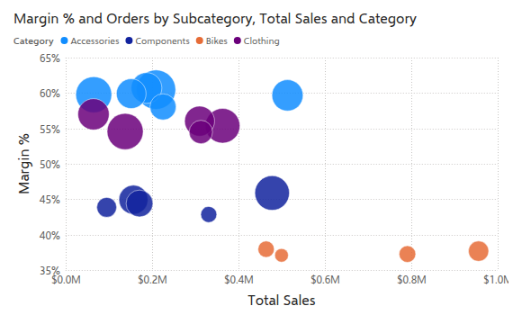

# Scatter charts

> **Applies to:** Creators · Analysts

A scatter chart (`scatterChart`) places one point per category value at the position given by two measures. With a third measure in **Size** it becomes a bubble chart, and with a **Play axis** it animates through time.

## When to use

- To show whether two measures move together (sales and margin, price and units) and to spot outliers.
- To compare many items on two or three measures at once; a table of the same numbers is harder to scan.
- Avoid it for a handful of points or for time series: use a [bar chart](bar-and-column-charts.md) or a [line chart](line-and-area-charts.md).

## Field wells

| Well | Takes | Notes |
|---|---|---|
| Values | Columns or hierarchies | One point per value. A hierarchy enables drill down. |
| X-axis | One measure | Horizontal position. |
| Y-axis | One measure | Vertical position. |
| Legend | One column | Colors the points by series. |
| Size | One measure | Bubble size. |
| Play axis | One column | Animates the chart: one frame per value. |
| Tooltips | Measures | Extra values in the tooltip. |

## Format options

The **Visual** tab groups the options as follows; the [format properties reference](../reference/format-properties/scatter-charts.md) lists every property.

- **Legend**, **X-axis**, **Y-axis**.
- **Markers** (colors per series), **Bubbles** (**Size**, **Range scaling**, **Shape**, **Auto-fit markers**), **Marker border**, **Fill point**, **Color border**, **Color by category**.
- **Category label**: the category name next to each point.
- **Plot area background**.

The **Analytics** tab ("Add further analyses to your visual") offers X-axis and Y-axis constant lines, min, max, average, median and percentile lines on either measure, a trend line, a **Ratio line** (through the origin, slope = sum of Y ÷ sum of X) and **Symmetry shading** (shades the areas above and below the line y = x).

## Interactions

- Select a point to cross-filter or cross-highlight the page; Ctrl+click adds to the selection.
- With a **Play axis**, the chart shows a play / pause button and a slider with one tick per frame; the current frame is shown as a watermark in the top-right corner of the plot, and selected points leave a trail.
- Drill down and up on a hierarchy in **Values**.

## Differences from Power BI Desktop

- Bubble sizes follow the constants of Power BI's open-source scatter chart, but how **Bubbles > Size** (-100 to 100) scales the radius is not documented: Lumen scales the radius linearly, so bubble sizes can differ slightly.
- Symmetry shading uses the theme's good and bad sentiment colors by default because Power BI's default shading colors are not documented.

## Related content

- [Bar and column charts](bar-and-column-charts.md)
- [Visual interactions](../create-reports/visual-interactions.md)
- [Format a visual](../create-reports/format-a-visual.md)
- [Format properties: scatter charts](../reference/format-properties/scatter-charts.md)
