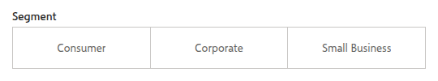
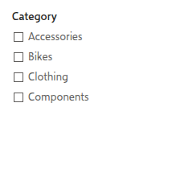
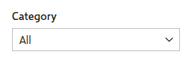
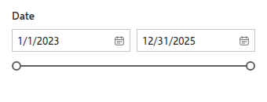
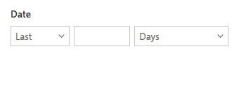
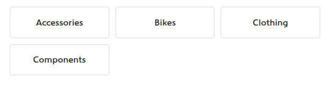
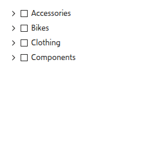
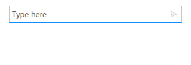

# Slicers

> **Applies to:** Creators · Analysts

Slicers are visuals that filter the other visuals on the page. Lumen has the four slicer visuals of Power BI Desktop: the classic **Slicer** (`slicer`) with all its styles, the **Button slicer** (`advancedSlicerVisual`), the **List slicer** (`listSlicer`) and the **Text slicer** (`textSlicer`). This article describes each visual; to build a page of slicers step by step, see [Slicers](../create-reports/slicers.md) in the Create reports section.

## Slicer styles

The classic **Slicer** changes its look with **Format visual > Visual > Slicer settings > Style**:

| Style | Use it for | Screenshot |
|---|---|---|
| **Vertical list** | A list of check boxes. Turn **Options > Orientation** to **Horizontal** for tiles (above). |  |
| **Dropdown** | A compact header that opens the list. |  |
| **Between** | A range of numbers or dates, with two inputs and a slider. |  |
| **Before / Less than or equal to**, **After / Greater than or equal to**, **Single value** | One bound or one value of a number or date. | |
| **Relative date**, **Relative time** | A rolling period (Last / Next / This, a number, a unit). |  |
| **Date picker** | A calendar button with **Manual** and **Relative** tabs. | |

## Other slicer visuals

- **Button slicer**: a grid of formatted buttons (fill, border, value and label text, image, accent bar, selection icon, shadow), each with its own look for the default, hover, pressed and selected states.
- **List slicer**: a list that also shows hierarchies; put several levels in **Field** and expand them with the arrows.
- **Text slicer**: a search box that keeps the rows whose field contains the text you type.

## Field wells

| Visual | Well | Takes |
|---|---|---|
| Slicer | Field | Columns or hierarchies |
| Button slicer | Field, Label | A column, and a measure for the label under each value |
| List slicer | Field | Columns or hierarchy levels |
| Text slicer | Field | One column |

## Format options

The [format properties reference](../reference/format-properties/slicers.md) lists every property.

- **Slicer**: **Slicer settings** (**Style**, **Inverted selection**), **Options** (**Orientation**, **Search**), **Selection** (**Single select**, **Multi-select with CTRL**, **Show "Select all" option**), **Slicer header**, **Values**, **Selection icon**, **Slider**, **Dropdown**, **Search box**, **Date range**, **Numeric inputs**, **Date inputs**, the date picker's **Button** and text cards, and **Lumen options**.
- **Button slicer**: **Multi-button layout**, **Overflow**, **Shape**, **Button fill**, **Button border**, **Callout values**, **Label**, **Image**, **Accent bar**, **Selection icon**, **Shadow**, **Button padding**, **Selection**, **Lumen options**.
- **List slicer**: **Slicer settings**, **Options**, **Selection**, **Values**, **Selection pills**, **Dropdown drawer**, **Lumen options**.
- **Text slicer**: **Input box** (placeholder text and color, font, background, border, accent bar, padding).

### Lumen options

The **Lumen options** card exists only in Lumen. Its defaults reproduce Power BI; change them to:

- **Dropdown summary**: what a closed dropdown shows: Power BI's "Multiple selections", the values ("A, B +3"), a count ("3 of 12 selected") or removable chips.
- **Clear button in dropdown**, **Dropdown width** and **Dropdown max height**.
- **Sort items** (model order, A to Z, Z to A, by count, or by a measure named in **Sort by measure**), **Show selected first**, **Show value counts**.
- **Date presets** (date fields) and **Force selection**.

These settings are saved in the report under a Lumen-only object (`lumenSlicer`); Power BI Desktop is designed to ignore objects it does not know, but this is not verified.

## Interactions

- A slicer filters every visual on the page (and, with [sync slicers](../create-reports/sync-slicers.md), on other pages), unless you change it with [edit interactions](../create-reports/visual-interactions.md).
- Two slicers on different columns of the same table do not filter each other's items: like Power BI, a slicer lists all values of its column, and a visual-level filter on a measure keeps only items with data.
- Right-click a slicer for its own entries such as **Search** and **Clear selections**.
- The selection is saved in the report when you save it.

## Differences from Power BI Desktop

- The date picker's **Relative** tab layout and the start and end inputs are not shown in any published screenshot, so their layout is Lumen's.
- A relative date with **Include today** off shifts the window by one day; the rows are the same as Power BI's, but the saved filter shape can differ.
- With **Date presets**, quarter presets are saved as fixed date ranges, so they do not roll over to the next quarter by themselves.
- Button slicer: the default look of the selected state and the meaning of some orientation and overflow settings are not documented and are approximations.
- When a saved slicer selection uses a value that Lumen replaced with a sample stand-in (sample data generated for a report whose data source was not reachable), the slicer shows a **Sample stand-in** notice.

## Related content

- [Slicers (how-to)](../create-reports/slicers.md)
- [Sync slicers](../create-reports/sync-slicers.md)
- [Filters pane](../create-reports/filters-pane.md)
- [Visual interactions](../create-reports/visual-interactions.md)
- [Format properties: slicers](../reference/format-properties/slicers.md)
