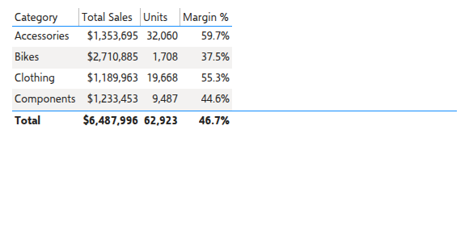
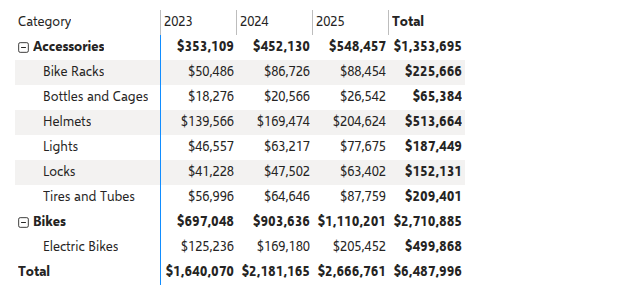

# Tables and matrices

> **Applies to:** Creators · Analysts

Tables and matrices show numbers in rows and columns. A **Table** (`tableEx`) lists one row per combination of its columns; a **Matrix** (`pivotTable`) groups rows and columns by fields, with subtotals, totals, expand / collapse and drill.

## When to use

- Use a **table** for detail lists (products, customers, orders) where readers look up exact values.
- Use a **matrix** for cross-tabulations (category by year) and for hierarchies that readers expand.
- Add [conditional formatting](../create-reports/conditional-formatting.md) (background color, font color, data bars, icons, web URL) to make patterns visible.

## Field wells

| Visual | Well | Takes | Notes |
|---|---|---|---|
| Table | Columns | Columns and measures | One column per field, in order. |
| Matrix | Rows | Columns or hierarchies | Several fields make row levels. |
| Matrix | Columns | Columns or hierarchies | Several fields make column levels. |
| Matrix | Values | Measures | One value column per measure. |

> [!WARNING]
> In this version, dragging a whole hierarchy (for example **Product Hierarchy**) into a well adds its levels in alphabetical order (Category, Product, Subcategory) instead of the hierarchy's order. Drag the levels one at a time, in the order you want, or reorder them in the well with the field menu > **Move** > **Up** / **Down**.

## Format options

The [format properties reference](../reference/format-properties/tables-and-matrices.md) lists every property.

**Table** (Visual tab): **Layout** (**Column width**: fit to content, grow to fit or fixed width, and a default width), **Grid**, **Values**, **Column headers**, **Totals**, **Specific column** (formatting per column), **Cell elements** (conditional formatting per value column).

**Matrix** (Visual tab): **Layout** (**Freeze** > **Row headers**, and **Column width**), **Layout and style presets**, **Grid**, **Values**, **Column headers**, **Row headers**, **Subtotals**, **Row grand total**, **Column grand total**, **Blank rows**, **Specific column**, **Subtotals per level**, **Cell elements**.

You can also resize a column by dragging the edge of its header, and double-click the edge to fit the column to its content; right-click a header for **Set column width** and **Reset column width**.

## Interactions

- Click a column header to sort by it (click again to reverse the sort).
- Select a row (table) or a cell or header (matrix) to cross-filter the page; Ctrl+click adds to the selection. Tables and matrices are cross-filtered, not cross-highlighted, by other visuals.
- Ctrl+C copies the selected cells as tab-separated text; right-click > **Copy** > **Copy value** or **Copy selection**.
- Matrix: the +/- icons expand and collapse a row or column header; right-click > **Expand** and **Collapse** > **Selection**, **Entire level** or **All**. The drill buttons in the visual header drill on rows or columns (**Drill on** in the header).

## Differences from Power BI Desktop

- Like Power BI, tables and matrices load 500 rows at a time and load more as you scroll; totals are computed by their own queries and stay exact. Automatic minimum and maximum values of conditional formatting (gradients, data bars) are computed over the rows loaded so far, not over all rows.
- Sparklines saved in a report render (line or column, markers, colors), but Lumen has no command to add a sparkline. Which marker bit means which marker is not documented by Microsoft and follows the order of Power BI's Format pane.
- Row padding (3 px) and some grid line colors are measured, not published values.
- The Layout card's **Column width** options are stored in the report's PBIR (`columnHeaders.columnAdjustment`, `columnWidth`); how **Grow to fit** treats columns with a custom width is Lumen's reading of the behaviour.

## Related content

- [Conditional formatting](../create-reports/conditional-formatting.md)
- [Sort and top N](../create-reports/sort-and-top-n.md)
- [Drill down and drill through](../create-reports/drill-down-and-drillthrough.md)
- [Export data from a visual](../create-reports/export-data-from-a-visual.md)
- [Format properties: tables and matrices](../reference/format-properties/tables-and-matrices.md)
